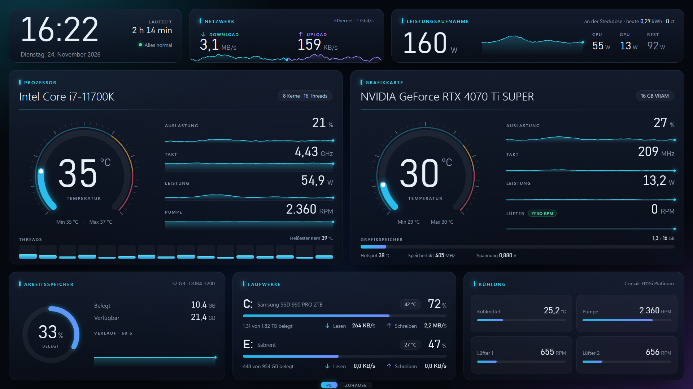
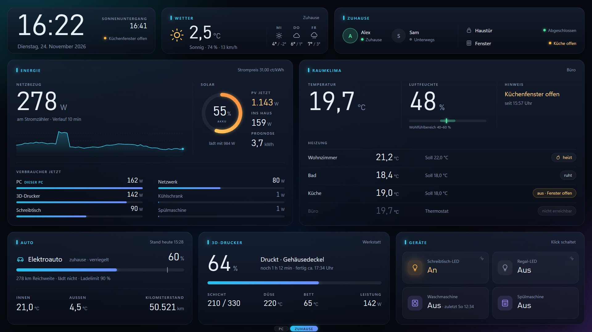
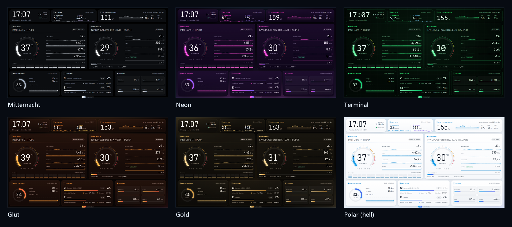
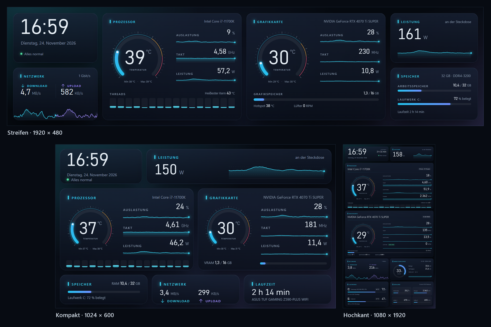
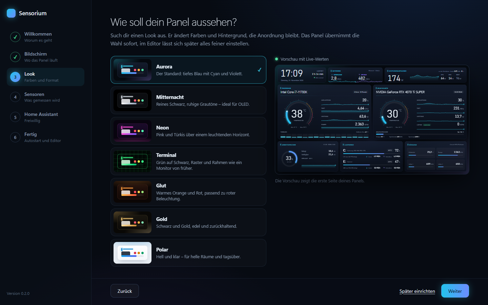
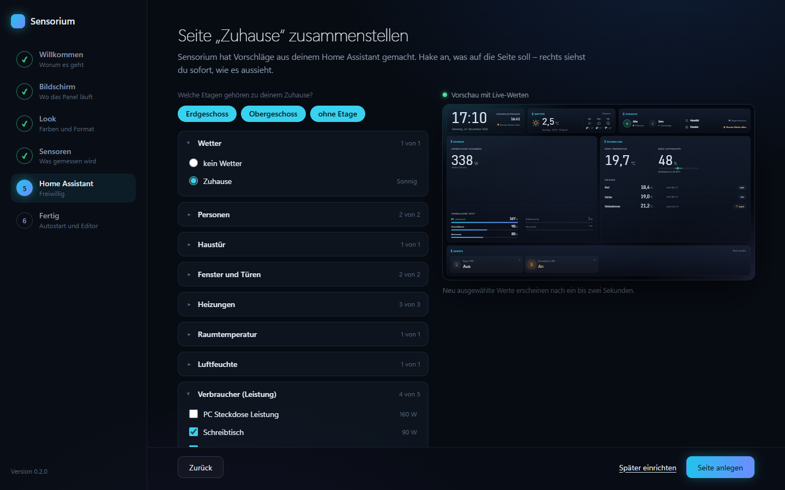
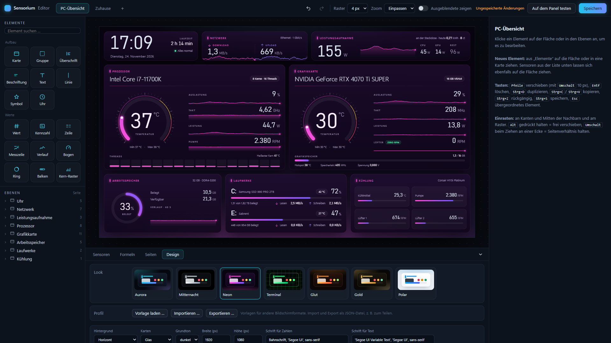

# Sensorium

[](https://github.com/DandeMC/sensorium/releases/latest)
[](LICENSE)


**Sensor-Panel für Windows.** Sensorium zeigt CPU, Grafikkarte, Arbeitsspeicher, Laufwerke, Netzwerk, Lüfter und FPS randlos auf einem zweiten Bildschirm – und auf Wunsch eine zweite Seite mit deinem Zuhause aus Home Assistant. Gedacht als moderner, kostenloser Ersatz für ein AIDA64-SensorPanel.

Sensorium wurde mit [Claude Code](https://claude.com/claude-code) geschrieben, dem KI-Programmierassistenten von Anthropic.

*English summary: [see below](#english-summary).*





## Funktionen

- **PC-Seite ohne Einrichtung:** CPU (Temperatur, Takt, Last je Thread, Leistung), Grafikkarte, Arbeitsspeicher, Laufwerke, Netzwerk, Lüfter und Pumpe. Sensorium erkennt die Sensoren selbst und ordnet sie zu.
- **FPS** des Spiels im Vordergrund (über RTSS). Startet ein Spiel, wechselt die Leistungskachel automatisch auf die Framerate.
- **Corsair-AIO** (Hydro Platinum, Pro XT, iCUE Elite RGB) wird direkt per USB gelesen, parallel zu iCUE und nur lesend.
- **Zuhause-Seite** (optional) mit Home Assistant: Wetter, wer zuhause ist, Haustür und Fenster, Energie, Heizung und Geräte, die du per Mausklick schaltest.
- **Tasmota-Steckdosen** (optional) werden jede Sekunde direkt abgefragt, z. B. für den Verbrauch des ganzen PCs.
- **Sieben Looks** per Klick: Aurora, Mitternacht (OLED), Neon, Terminal, Glut, Gold und das helle Polar – oder eigene Farben.
- **Vorlagen für andere Bildschirme:** Streifen (1920 × 480), Kompakt (1024 × 600) und Hochkant (1080 × 1920).
- **Einrichtungsassistent** beim ersten Start – Look, passende Vorlage, Sensoren und Home Assistant. Home Assistant ist freiwillig, ein „Nein“ reicht.
- **Editor:** Panel mit der Maus gestalten – verschieben, Größe ändern, Sensoren hineinziehen, Farben, Formeln, Seiten. Mit Rückgängig, Live-Werten und Probe auf dem Panel.
- **Profile teilen:** Import und Export als Datei, mit Prüfung vor dem Import.
- **Mehrere Seiten:** Umschalten per Klick oder Mausrad. Klicks holen das Panel nicht in den Vordergrund, das Spiel behält den Fokus.
- **Kein Konto, keine Cloud:** Sensorium selbst sendet nichts ins Internet. Es spricht nur mit deinem Home Assistant und deinen Steckdosen, wenn du sie einrichtest. Die Anzeige lädt nichts aus dem Netz nach, auch nicht über ein Profil.

## Looks



Ein Look ändert Farben, Hintergrund und Kartenstil, die Anordnung bleibt. Auswählen lässt er sich im Assistenten (Schritt „Look“) oder im Editor im Reiter „Design“. Dort kannst du jede Farbe auch einzeln anpassen.

## Andere Bildschirmformate



Das Standard-Layout ist für 1920 × 1080 gebaut. Für schmale Leisten, kleine 7-Zoll-Displays und Monitore im Hochformat gibt es eigene Vorlagen. Hat dein Panel-Bildschirm ein anderes Format, schlägt der Assistent die passende Vorlage vor. Im Editor findest du sie unter „Design“ → „Vorlage laden …“. Andere Größen werden passend skaliert.

## Voraussetzungen

| | |
|---|---|
| **Windows 10 oder 11** (64 Bit) | |
| **Zweiter Bildschirm** | Vorlagen für 1920 × 1080, 1920 × 480, 1024 × 600 und 1080 × 1920. Andere Größen werden skaliert. |
| **WebView2-Runtime** | Ist bei Windows 11 dabei, bei Windows 10 meist auch. Sonst: [WebView2 herunterladen](https://developer.microsoft.com/microsoft-edge/webview2/) (Evergreen Bootstrapper). |
| **Adminrechte** | Viele Hardware-Sensoren lassen sich nur mit Adminrechten lesen. Sensorium fragt beim Start danach. |
| **PawnIO-Treiber** (empfohlen) | Nötig für CPU-Temperatur, CPU-Takt und -Leistung sowie Lüfter am Mainboard: [pawnio.eu](https://pawnio.eu/). Der Assistent zeigt, ob er fehlt. |
| **RTSS** (optional) | RivaTuner Statistics Server liefert die FPS. Kommt z. B. zusammen mit MSI Afterburner. |
| **Home Assistant** (optional) | Für die Seite „Zuhause“. |

Eine .NET-Installation ist **nicht** nötig, sie steckt im Download.

## Installation

1. Lade die neueste `Sensorium-…-win-x64.zip` unter **[Releases](https://github.com/DandeMC/sensorium/releases/latest)** herunter.
2. Rechtsklick auf die ZIP-Datei → **Eigenschaften** → unten **Zulassen** anhaken → OK. (Sonst warnt Windows bei jeder Datei aus dem Internet.)
3. Entpacke den Ordner an einen festen Ort, z. B. `%LOCALAPPDATA%\Programs\Sensorium`.
4. Starte `Sensorium.exe`.
   - Erscheint **„Der Computer wurde durch Windows geschützt“**: auf **Weitere Informationen** → **Trotzdem ausführen** klicken. Sensorium ist nicht digital signiert, deshalb fragt SmartScreen nach.
   - Windows fragt nach **Adminrechten** → **Ja**.
5. Der **Einrichtungsassistent** öffnet sich und führt durch den Rest.

Tipp: Rechtsklick auf `Sensorium.exe` → **An „Start“ anheften**, damit du es schnell wiederfindest.

### Update

Rechtsklick auf das Sensorium-Symbol unten rechts → **Beenden**. Danach die neue ZIP in denselben Ordner entpacken und dabei überschreiben. Einstellungen, Zuordnungen und eigene Profile liegen in `%APPDATA%\Sensorium` und bleiben erhalten.

### Deinstallieren

1. Rechtsklick auf das Symbol → **Mit Windows starten** ausschalten (entfernt die Aufgabe in der Aufgabenplanung).
2. **Beenden**.
3. Den Programmordner löschen. Wer auch alle Einstellungen loswerden will, löscht außerdem `%APPDATA%\Sensorium` und `%LOCALAPPDATA%\Sensorium`.

## Einrichtung

Beim ersten Start führt ein Assistent in sechs Schritten durch alles:

1. **Willkommen** – was Sensorium kann.
2. **Bildschirm** – auf jedem Monitor erscheint kurz eine große Nummer, du klickst den passenden an.
3. **Look** – Farben auswählen, mit Live-Vorschau. Passt das Layout nicht zum Bildschirm (z. B. eine schmale Leiste), schlägt der Assistent die passende Vorlage vor.
4. **Sensoren** – zeigt, ob Adminrechte, PawnIO, RTSS und eine Corsair-AIO erkannt wurden, und hilft beim Nachrüsten.
5. **Home Assistant** – freiwillig. Bei „Ja“: Adresse und Zugriffstoken eingeben, testen, dann schlägt Sensorium passende Geräte vor (nach Etagen filterbar). Du hakst an, was auf die Seite soll, und siehst sofort eine Vorschau mit Live-Werten.
6. **Fertig** – Autostart einschalten, fertig.





Der Assistent lässt sich jederzeit wieder öffnen: Rechtsklick auf das Symbol → **Einrichtung …**

## Bedienung

- **Doppelklick** auf das Symbol unten rechts blendet das Panel ein und aus.
- **Rechtsklick** öffnet das Menü:
  - **Panel bearbeiten …** – der Editor
  - **Monitor** – auf welchem Bildschirm das Panel liegt
  - **Sensoren und Zuordnung …** – alle Sensoren mit Live-Werten; hier lässt sich z. B. ändern, welcher Sensor als „Pumpe“ gilt
  - **Home Assistant verbinden …** und **Einrichtung …**
  - **Mit Windows starten** – legt eine Aufgabe in der Aufgabenplanung an; Sensorium startet dann beim Anmelden mit Adminrechten, ohne UAC-Abfrage
  - **Profil bearbeiten (JSON) …**, **Datenordner öffnen**, **Beenden**
- **Seiten umschalten:** Klick auf die Knöpfe unten in der Mitte des Panels oder Mausrad über dem Panel.

## Editor

Rechtsklick auf das Symbol → **Panel bearbeiten …**



- **Fläche** mit Live-Werten: Elemente anklicken, verschieben, an den Anfassern in der Größe ändern. Sie rasten an Kanten, Mitten und am Raster ein (`Alt` = frei, `Umschalt` an einer Ecke = Seitenverhältnis halten).
- **Elemente** links anklicken oder auf die Fläche bzw. in eine Karte ziehen. **Ebenen** zeigen den Aufbau der Seite.
- **Eigenschaften** rechts: Position, alle Einstellungen des Elements, Farbregeln, Sichtbarkeit (Bedingungen) und „Erweitert“ (alles als JSON).
- **Unten:** Sensoren (auch alle Entitäten aus Home Assistant, nach Etage filterbar; auf die Fläche ziehen = neues Element), Formeln (mit „Testen“), Seiten (Umschalter, automatischer Wechsel) und Design (Looks, Vorlagen, Import und Export, Hintergrund, Kartenstil, einzelne Farben, Größe).
- **Tasten:** Pfeile, Entf, Strg+D, Strg+C/X/V, Strg+Z/Y, Strg+S, Esc.
- **Auf dem Panel testen** zeigt den Entwurf auf dem Panel, ohne zu speichern. **Speichern** schreibt dein eigenes Profil nach `%APPDATA%\Sensorium\profiles`; die vorige Fassung landet in `profiles\Sicherungen`.

## Profile teilen

Im Editor unter **Design** → **Exportieren …** speicherst du dein Profil als JSON-Datei, mit **Importieren …** lädst du eins. So lassen sich Layouts weitergeben.

- **Beim Import** zeigt Sensorium vorher, was in der Datei steckt: ein anderes Bildschirmformat, Home-Assistant-Werte, die es bei dir nicht gibt, und Kacheln, die Geräte schalten würden. Schalten ist erst erlaubt, wenn du es ausdrücklich anhakst. Verweise auf Inhalte aus dem Internet werden entfernt. Übernommen wird erst mit **Speichern**, Strg+Z macht den Import rückgängig.
- **Beim Export** weist Sensorium darauf hin, wenn das Profil Namen aus deinem Home Assistant (z. B. Personen, Räume) oder Adressen von Steckdosen enthält. Zugangsdaten stehen nie in einem Profil.

## Home Assistant

Am einfachsten über den Assistenten. Von Hand: Rechtsklick → **Home Assistant verbinden …**

- **Adresse:** z. B. `http://homeassistant.local:8123` oder die IP-Adresse deines Home Assistant.
- **Zugriffstoken:** In Home Assistant links unten auf deinen Namen → Reiter **Sicherheit** → ganz unten **Langlebige Zugriffstoken** → **Token erstellen**. Den Token gleich kopieren, er wird nur einmal angezeigt.
- Der Token liegt verschlüsselt in `%APPDATA%\Sensorium\ha-token.bin` (Windows-DPAPI, nur für dein Benutzerkonto lesbar). Er steht nie im Profil.
- Sensorium abonniert nur die Entitäten, die das Profil anzeigt. Schalten kann es nur Kacheln, die ausdrücklich dafür freigegeben sind (`"toggle": true`; Lampen, Schalter, Ventilatoren, `input_boolean`).
- Ohne Home Assistant läuft alles andere ganz normal, die Seite „Zuhause“ wird dann einfach nicht angezeigt.

## Tasmota-Steckdosen

Steckdosen mit Tasmota lassen sich direkt abfragen, ganz ohne Home Assistant und sekundengenau (Home Assistant bekommt ihre Werte oft nur alle 30 Sekunden). Beispiel für eine Formel oder einen Text im Profil:

```
{tasmota:192.168.1.50/power}
```

Verfügbar sind `power`, `today`, `yesterday`, `total`, `voltage`, `current` und `factor`. Sensorium liest nur (Befehl „Status 8“) und braucht dafür eine Steckdose ohne Web-Passwort. Im Assistenten kannst du bei „PC an der Steckdose“ die Adresse eintragen.

## Profile und Formeln

Das Aussehen steht in einem Profil (JSON). Der Editor erledigt das meiste; wer lieber direkt schreibt:

- Ein Profil hat `canvas` (Größe), `theme`, `formulas` und `pages[].widgets`. Jedes Element hat `type`, die Position `x`/`y`/`w`/`h` und je nach Typ weitere Felder. Kinder (`children`) liegen relativ zu ihrer Karte.
- **Theme:** `colors` (u. a. `bg`, `text`, `muted`, `accent`, `accent2`, `warn`, `crit`, `ok`, `card-top`, `card-bottom`), `gradients`, `fonts`, `background` (`aurora`, `glow`, `horizon`, `grid`, `plain`), `cards` (`glass`, `flat`, `outline`) und `tone` (`dark` oder `light`).
- **Sensoren** werden über Zuordnungen angesprochen (`cpu.temp`, `gpu.load`, `sys.ram.used`, `drive.C.temp`, `fps.current` …) oder direkt über ihre ID in `{…}`.
- **Home Assistant:** `ha:sensor.x` (Zustand), `ha:sensor.x#state` (Zustand im Original, z. B. `unavailable`), `ha:sensor.x#changed` (letzte Änderung), `ha:climate.y@current_temperature` (Attribut).
- **Formeln:** `"formulas": { "pc.wall": { "label": "PC an der Steckdose", "expr": "first({tasmota:192.168.1.50/power}, {ha:sensor.pc_steckdose_leistung})" } }`. Rechnen mit `+ − * /`, Funktionen `avg`, `min`, `max`, `sum`, `list`, `first`, `round`, `abs`, `pos`.
- **Platzhalter in Texten:** `{cpu.temp:0} °C`, `{sys.net.down|rate}`, `{sys.uptime|dur}`, `{ha:person.x|de}` (Zustand auf Deutsch), `{ha:sun.sun@next_setting|clock}`, `{…|when}` („gestern 12:34“), `{…|mins}`, `{ha:lock.x|map:locked=zu,unlocked=offen}`.
- **Farben** verweisen aufs Theme: `"@accent"`, `"@warn"`, `"@crit"`. **Regeln** färben Werte: `"rules": [{ "from": 70, "color": "@warn" }, { "from": 85, "color": "@crit", "pulse": true }]`.
- **Bedingungen** blenden ein oder aus: `"visibleIf": { "sensor": "fps.current", "gt": 0 }`, für Zustände `{ "sensor": "ha:binary_sensor.x", "eq": "on" }`, außerdem `ne`, `in`, `notIn`, `any` (oder) und Listen (und).
- **Seiten:** `pages` mit `id`, `name`, `short`; `"requires": "ha"` blendet eine Seite aus, solange Home Assistant nicht eingerichtet ist. `autoPage` wechselt automatisch, z. B. zur PC-Seite, sobald ein Spiel läuft.

Elemente: `card`, `group`, `header`, `text`, `label`, `clock`, `value`, `spark`, `metric`, `gauge`, `ring`, `bar`, `threads`, `kv`, `stat`, `drive`, `fanlist`, `status`, `box`, `icon`, für Home Assistant außerdem `weather`, `forecast`, `people`, `states`, `state`, `consumers`, `climate`, `range` und `tile`.

Ein vollständiges Beispiel mit PC-Seite und Seite „Zuhause“ steht in [`docs/beispiel-profil.json`](docs/beispiel-profil.json). Die Entitäten darin sind Platzhalter und müssen an das eigene Home Assistant angepasst werden.

## Kommandozeile

| Option | Wirkung |
|---|---|
| `--editor` | Editor öffnen (läuft Sensorium schon, öffnet die laufende Instanz ihn) |
| `--setup` | Einrichtungsassistent öffnen |
| `--no-elevate` | ohne Adminrechte starten |
| `--demo [normal\|gaming]` | simulierte Werte statt echter Sensoren |
| `--probe <datei>` | alle Sensoren, Werte und Zuordnungen als JSON speichern |
| `--screenshot <datei> [--page sensors] [--delay s]` | Panel oder Sensorliste als PNG speichern |
| `--corsair-dump <datei>` | Diagnose der Corsair-AIO |
| `--devtools` | Entwicklerwerkzeuge in den Fenstern aktivieren |

## Ordner

| Was | Wo |
|---|---|
| Einstellungen, Zuordnungen, eigene Profile, Logs | `%APPDATA%\Sensorium` |
| WebView2-Daten | `%LOCALAPPDATA%\Sensorium` |
| Mitgeliefertes Profil | `Profiles\standard.json` im Programmordner |
| Layout-Vorlagen | `Profiles\vorlagen` im Programmordner |

In `%APPDATA%\Sensorium\settings.json` gibt es ein paar Schalter ohne eigene Oberfläche, z. B. `"corsairUsb": false` (AIO nicht lesen) und `fpsIgnore` (Programme, die keine Spiele sind und deshalb keine FPS zeigen sollen).

## Aus dem Quellcode bauen

Voraussetzung: [.NET 10 SDK](https://dotnet.microsoft.com/download/dotnet/10.0).

```powershell
git clone https://github.com/DandeMC/sensorium.git
cd sensorium
dotnet build src/Sensorium -c Release
```

- `scripts\publish.ps1 -Shortcut -Run` installiert die eigene Fassung nach `%LOCALAPPDATA%\Programs\Sensorium`, legt Verknüpfungen im Startmenü an und startet sie (braucht die .NET 10 Desktop Runtime). Läuft Sensorium bereits, beendet es sich vorher selbst.
- `scripts\release.ps1` baut die eigenständige ZIP-Datei wie unter Releases nach `artifacts\`.
- Build-Ausgaben landen unter `%LOCALAPPDATA%\Sensorium\build`, nicht im Quellordner (praktisch, wenn der Ordner synchronisiert wird).
- Die Oberfläche ist HTML/CSS/JavaScript in `src/Sensorium/Web` und lässt sich mit Demo-Werten im Browser ansehen: `python -m http.server 8765 --directory src/Sensorium`, dann `http://localhost:8765/Web/panel.html`, `setup.html` oder `editor.html` öffnen.

Aufbau: C# mit WinForms und WebView2. `Sensors/` enthält die Quellen (LibreHardwareMonitor, System, RTSS, Corsair-USB, Home Assistant, Tasmota), den Sensor-Hub und die Formelsprache, `Host/` die Fenster und das Tray-Menü.

## Lizenz und Dank

Sensorium steht unter der [MIT-Lizenz](LICENSE). Verwendete Bibliotheken und ihre Lizenzen: [THIRD-PARTY-NOTICES.md](THIRD-PARTY-NOTICES.md).

Danke an [LibreHardwareMonitor](https://github.com/LibreHardwareMonitor/LibreHardwareMonitor), [HidSharp](https://software.seekye.com/hidsharp), [PawnIO](https://pawnio.eu/), RivaTuner Statistics Server, [Home Assistant](https://www.home-assistant.io/), [Tasmota](https://tasmota.github.io/) und die Protokoll-Dokumentation von [liquidctl](https://github.com/liquidctl/liquidctl) für die Corsair-AIOs.

Sensorium ist ein privates Projekt und steht in keiner Verbindung zu FinalWire (AIDA64), Corsair oder den anderen genannten Herstellern.

---

## English summary

**Sensorium** is a free sensor panel for Windows 10/11. It shows CPU, GPU, RAM, drives, network, fans and FPS full-screen on a secondary monitor, and optionally a second page with your smart home from Home Assistant (weather, people, doors and windows, energy, heating, and devices you can toggle with a mouse click). It reads Corsair AIO coolers (Hydro Platinum, Pro XT, iCUE Elite RGB) directly over USB and Tasmota smart plugs directly over HTTP.

- **Install:** download the latest `Sensorium-…-win-x64.zip` from [Releases](https://github.com/DandeMC/sensorium/releases/latest), unblock it (Properties → Unblock), unzip and run `Sensorium.exe`. The app is not code-signed, so SmartScreen may ask (More info → Run anyway). It requests admin rights because many hardware sensors need them. No .NET installation is required.
- **Recommended:** the [PawnIO](https://pawnio.eu/) driver for CPU temperature, clocks and motherboard fans; RTSS for FPS.
- **First run:** a setup wizard picks the monitor and a look, suggests a layout template if your panel screen is not 16:9, checks the sensors and, only if you want, connects Home Assistant and builds a "Zuhause" (home) page from your entities with a live preview.
- **Looks and formats:** seven themes (Aurora, Mitternacht for OLED, Neon, Terminal, Glut, Gold and the light Polar) and layout templates for 1920 × 1080, 1920 × 480 bar displays, 1024 × 600 7-inch displays and 1080 × 1920 portrait monitors.
- **Editor:** design the panel with the mouse (drag and drop, live values, undo, pages, formulas, colours). Profiles can be exported and imported; imports are checked first and may only toggle devices after you allow it.
- **Privacy:** no account, no telemetry, and the panel never loads content from the internet. The Home Assistant token is stored encrypted with Windows DPAPI.
- The user interface is in German. Licensed under the MIT license.
- Sensorium was written with [Claude Code](https://claude.com/claude-code), Anthropic's AI coding assistant.
